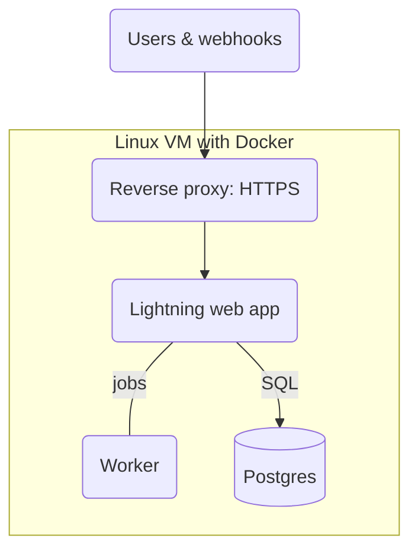
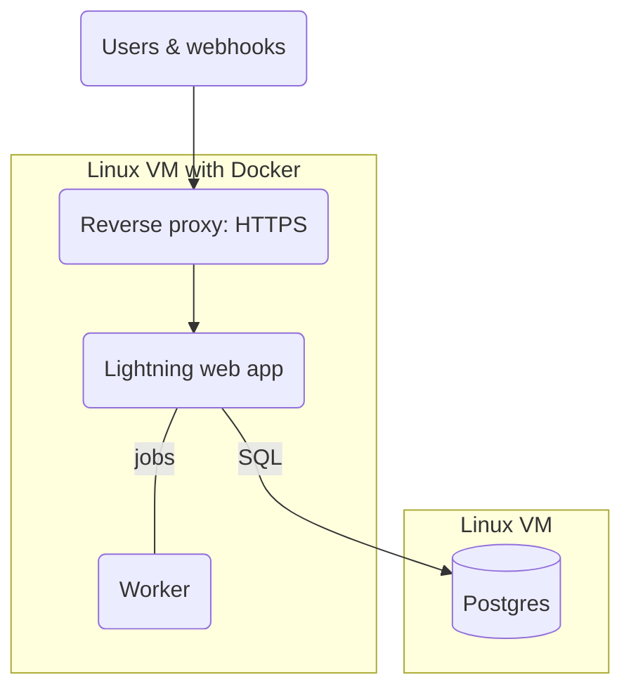
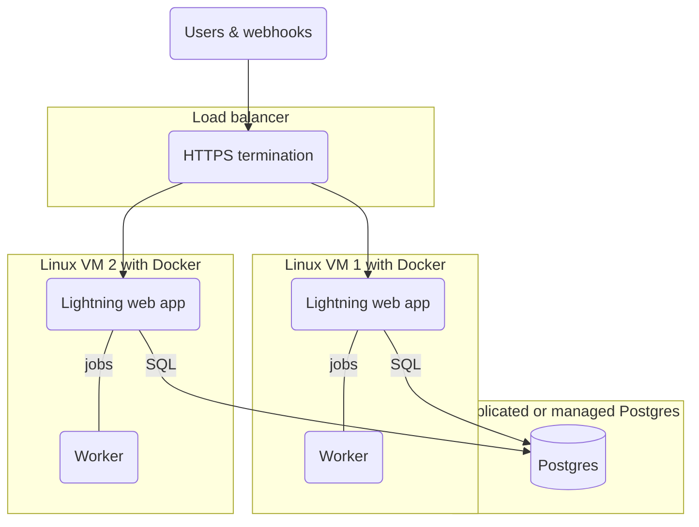
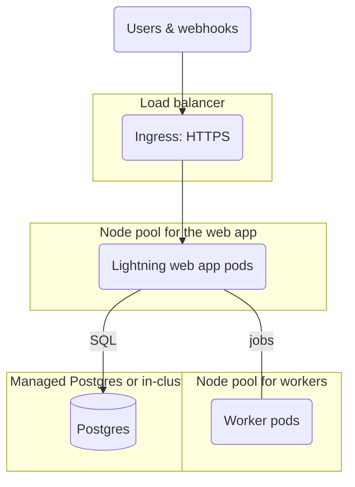

## Plan first

Not sure where to start? Head back to the [Planning](/deploy/options.md) page to
think about how you want to scale up your OpenFn automation projects.

## Assess your capacity

:::info Help your partner estimate up-front and ongoing costs

Use these questions to start assessing capacity and technical resources so that
your deployment partner can better estimate your total cost of ownership.

:::

1. Who will operate OpenFn after it is deployed? Name the person or team, and
   say whether they already run containerized applications (Docker or
   Kubernetes) in production. If nobody can be named yet, start with a pilot
   rather than a production deployment.
2. How do you currently deploy, monitor, and maintain cloud-based applications
   at your organization/government? All deployment environments and institutions
   are unique and OpenFn is flexible; based on your current DevOps processes we
   will recommend different deployment mechanisms.
3. What IT and DevOps staff resources are available to support OpenFn deployment
   and maintenance? Do they have experience with Docker & Kubernetes? Do they
   have experience with Postgres databases?
4. Will the deployment require high-availability? (i.e., if OpenFn will receive
   requests in real-time from other applications rather than run cron-based
   jobs, then at least two instances of OpenFn should be run simultaneously
   behind a load-balancer, making use of “distributed Erlang” to ensure graceful
   application redundancy; if OpenFn will not be responsible for receiving
   requests and will only be responsible for making relatively time-independent
   outbound requests on a cron schedule, the importance of maintaining a
   zero-downtime system is slightly reduced.)
5. Does OpenFn need to plug into tooling you already run, such as your own
   monitoring and alerting, secrets manager, CI/CD pipelines, or change-control
   process? Integrating with customer-specific tooling is scoped separately from
   a standard deployment.

## Knowledge Requirements

| Skill         | Relevance and reason                                                                                                                                                                                                                                       |
| ------------- | ---------------------------------------------------------------------------------------------------------------------------------------------------------------------------------------------------------------------------------------------------------- |
| Elixir/Erlang | The OpenFn **webapp/orchestration layer** is an Elixir application running on Erlang OTP.                                                                                                                                                                  |
| JavaScript    | The OpenFn **job processing workers** and OpenFn workflows themselves are JavaScript-based. With knowledge of how Node.js works you can build workflows that do _anything_.                                                                                |
| Postgres      | The default **database** for OpenFn is PostgreSQL                                                                                                                                                                                                          |
| Docker        | We publish all **OpenFn [images](https://hub.docker.com/orgs/openfn/repositories)** on Docker Hub. Whether you're streamlining developer setup or using container orchestration technologies, understanding Docker and containerized computing is helpful. |
| Kubernetes    | Kubernetes is one way to run **high-availability** deployments: it provides **load balancing** and simplifies **container management** across multiple hosts. Docker Engine across two or more nodes is the other supported option.                        |

## Machine Requirements

:::tip Start with a working container runtime

Every OpenFn deployment assumes a container runtime (Docker Engine or
Kubernetes) is already in place and operated by your team before deployment
begins. Kubernetes is _not_ required. For a pilot, a single Docker host is
enough. If your team can't yet provision and operate Docker hosts or a
Kubernetes cluster, address that gap first, for example with a local
implementation partner.

:::

The official OpenFn SaaS uses [Kubernetes](https://kubernetes.io/) for managed
deployments on Google Cloud. With dynamic workloads, it is important (for
stability and cost reasons) to be able to scale the Erlang OTP app node pool &
pods independently of the JavaScript worker node pool & pods.

1. For high-availability deployments, use a scalable SQL service and keep _at
   least_ two app nodes running, on Kubernetes or on Docker Engine across two or
   more hosts. On Kubernetes (GKE), Lightning forms its Erlang cluster
   automatically; elsewhere it uses gossip or Postgres-based node discovery (see
   Lightning's
   [deployment notes](https://github.com/OpenFn/lightning/blob/main/DEPLOYMENT.md)).
   Reference specs per app pod on GKE:
   1. **GKE requests:** cpu@ "500m", memory@ "1024Mi"
   2. **GKE limits:** memory@ "2560Mi"
2. For simple non-Kubernetes/HA deployments, the minimum recommended machines
   are:
   - **Application machine:** 2 vCPU (roughly a single core of a 2.6 GHz Intel
     Xeon E5) with 3.75 GB memory and 15 GB of storage for the application
     1. A currently supported Linux distribution that can run Docker Engine (for
        example, a current Ubuntu LTS or Debian stable release).
     2. A currently supported version of Docker Engine.
   - **Database machine:** 2 vCPU (roughly a single core of a 2.6 GHz Intel Xeon
     E5) with 3.75 GB memory. Storage required for the DB varies by how many
     days (if any) of message data you’d like to store on the app itself and
     cannot be determined without estimates for message/run throughput. If
     scaling physical storage is not difficult for your particular deployment,
     start at 40 GB.
     1. A Postgres (at least v14.2) instance, run on a _separate server_ from
        the application for greater stability. In production, Lightning connects
        to Postgres over SSL by default.
3. Hosting the application and database on the same machine is acceptable for a
   pilot but not recommended for production. That machine should have roughly
   the sum of the requirements above.
4. **Note** that the application by default provides an HTTP endpoint (no
   TLS/SSL). A reverse-proxy/load-balancer is expected to provide both HTTPS
   (HTTP2 compliant) and load balancing between instances.
   - _I.e., the application server provides no encryption for web access, a web
     server in front of the application needs to be provided; Nginx is a good
     start, provided with TLS certificates._
5. While network architecture is up to the client, we strongly **recommend a
   private subnet** for the application servers.
6. The OpenFn application does not need to be deployed on the same machine as
   any other services, however network routing and firewall rules will need to
   be provided in order for the integration to access the source and destination
   systems if hosted on different servers.
7. For **troubleshooting/external support**, administrators will need SSH access
   to an unrestricted account (`sudo` for Ubuntu) if deployment maintenance
   services are required.

## Beyond the servers

A production deployment needs more than compute and a database. Plan for these
before go-live:

- **Mail:** Lightning sends system emails (for example, password resets). It
  supports Mailgun or your own SMTP server.
- **Secrets:** Lightning needs an encryption key for credentials at rest and a
  set of worker keys. A `.env` file is fine for a pilot; production should use a
  proper secrets option suited to your runtime.
- **Monitoring and alerting:** know when the platform or a workflow stops doing
  its job. Lightning can expose Prometheus metrics.
- **Backups:** scheduled backups of the database, with restores that have
  actually been tested.
- **Upgrades and rollback:** a defined path for applying new OpenFn versions and
  rolling back if something goes wrong.

See Lightning's
[deployment notes](https://github.com/OpenFn/lightning/blob/main/DEPLOYMENT.md)
for the environment variables behind each of these.

## Possible Configurations

While your deployment strategy should be carefully considered with a DevOps
specialist, the following sample configurations may provide useful starting
points. See
[Local deployment with OpenFn](/deploy/options.md#local-deployment-with-openfn)
for how these map to the deployment tiers OpenFn offers.

### (a) Single Machine

Run the application, worker, and database on one machine. It's the simplest
setup and suits a pilot, but if that machine fails the service is unavailable
until it is restored.

### (b) Separate Persistence from Application

Run the application and worker on one machine and Postgres on another. Giving
the database its own server makes the system more stable and easier to back up.
Each machine is still a single point of failure, so this isn't high
availability.

### (c) High-Availability on Docker Engine

Run the application and worker on two or more Docker hosts behind a load
balancer, which also handles HTTPS. If one host fails, the others keep serving
requests. Use a replicated or managed Postgres service so the database doesn't
become the weak point.

### (d) High-Availability on Kubernetes

Run the web app and the worker in separate node pools that scale on their own,
each sized for its workload. This is how OpenFn's own cloud runs. For the
database, use a high-availability managed Postgres service or run Postgres in
the cluster.

