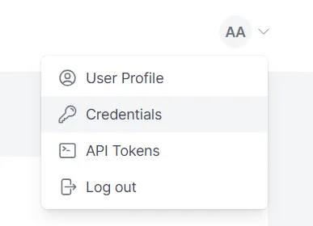
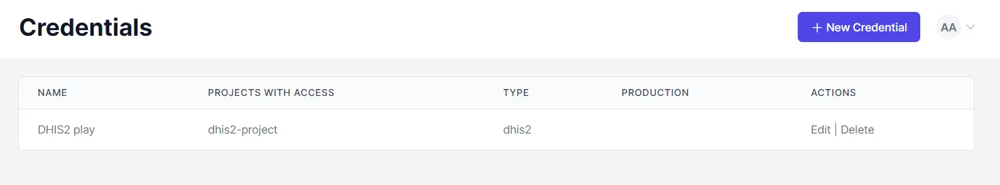
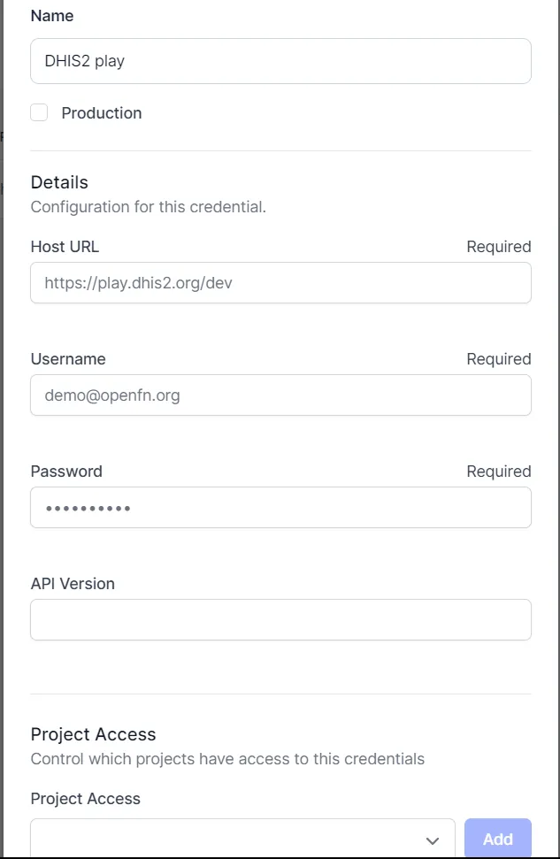
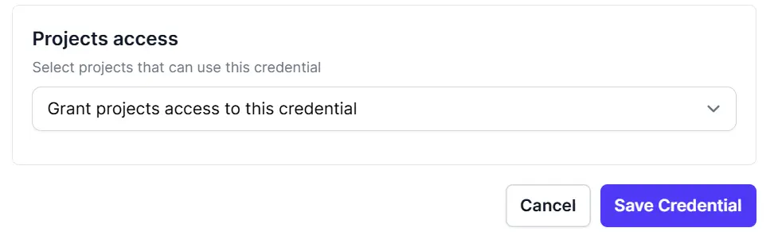
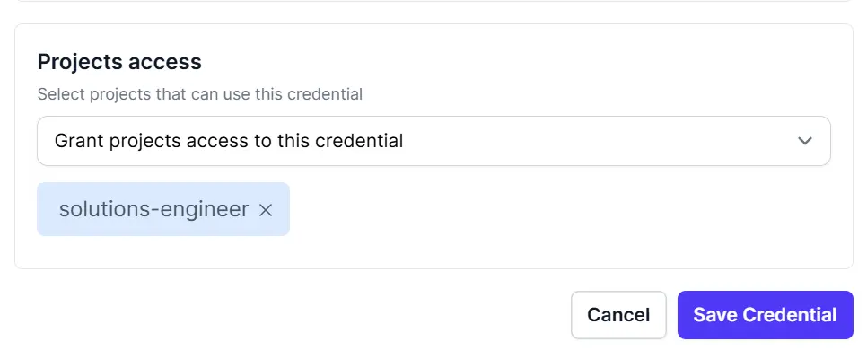

You can manage all the Credentials you own on the `Credentials` page. To open
it, click the user menu and choose `Credentials`.

## All your Credentials in one place

The `Credentials` page lets you add, view, edit or delete the Credentials you
own. It is the central place to manage your Credentials across all projects you
collaborate on.

For guidance on how to set up a new Credential, head over to our
[Manage Credentials](/manage-projects/manage-credentials.md) page.

To update the name and login details of a Credential, click the `Actions` button
on it and choose `Edit`. The edit form also has a tab for each of the
Credential's environments, where you can add, rename or delete an environment.
See [Environments](/build/sandboxes.md#environments).

## Share Credentials

You can also allow multiple projects to have access to a Credential you own.

Follow the steps below to give a project access to a credential:

1. Open the `Credentials` page and find the credential you are looking to share.
2. Click the `Actions` button on the credential and select `Edit`.
3. In the pop-up that follows look for a `Projects access` section at the
   bottom. 
4. Search for the target project in the dropdown and click on it. See that it is
   added below the dropdown and click the `Save Credential` button.
   

:::info Shared Credentials remain secret

If you share a Credential with a Project, Collaborators of that Project can
_use_ the Credential in their Workflows, but they won't be able to see the login
details contained.

:::

:::tip

If you want to share the login details contained in the Credential, use a secure
sharing protocol like a password manager or an encrypted messaging platform.

:::

## Transfer a Credential

You can hand ownership of a Credential to another user.

1. Click the `Actions` button on the Credential and choose `Transfer`.
2. Enter the email address of the new owner. They must be a member of every
   project where the Credential is used.
3. Click the `Transfer` button. We send you a confirmation email.
4. Open the link in the email to confirm the transfer.

Until you confirm, the menu item reads `Revoke Transfer`. Choose it to cancel
the transfer and keep the Credential. Once the transfer is complete, the new
owner can edit the Credential and share it with other projects, and you can no
longer manage it.

## Delete a Credential

To delete a Credential, click the `Actions` button on it and choose `Delete`.

Deleting a Credential removes it from all jobs and projects straight away. After
a cooling-off period its secrets are scrubbed for good. If the Credential was
used in runs, the record itself is kept until the related history expires.

During the cooling-off period, the `Actions` menu shows `Cancel deletion` and
`Delete now`. If you cancel the deletion, you need to share the Credential with
its projects again.
