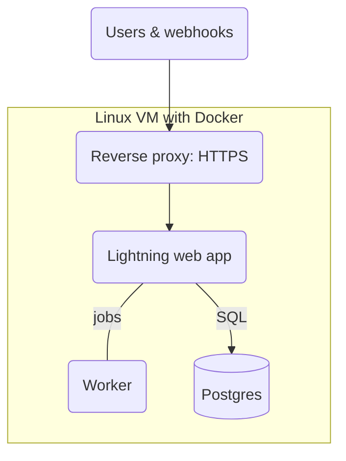
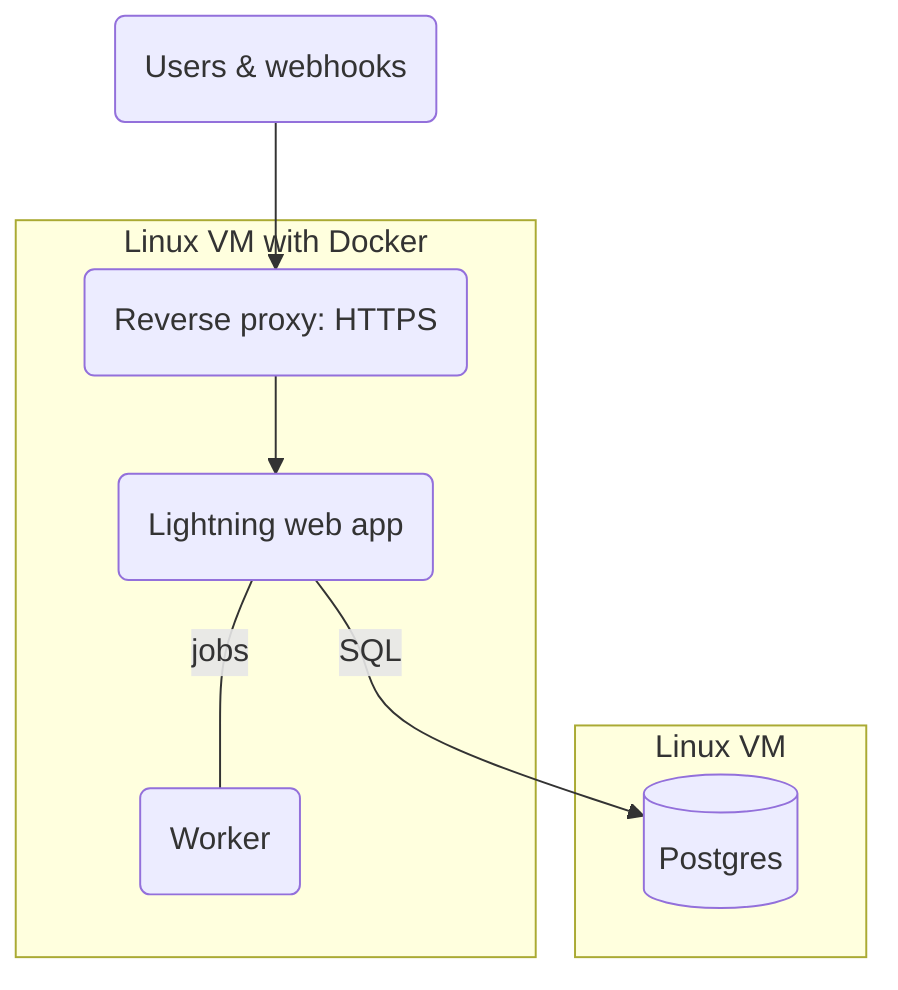
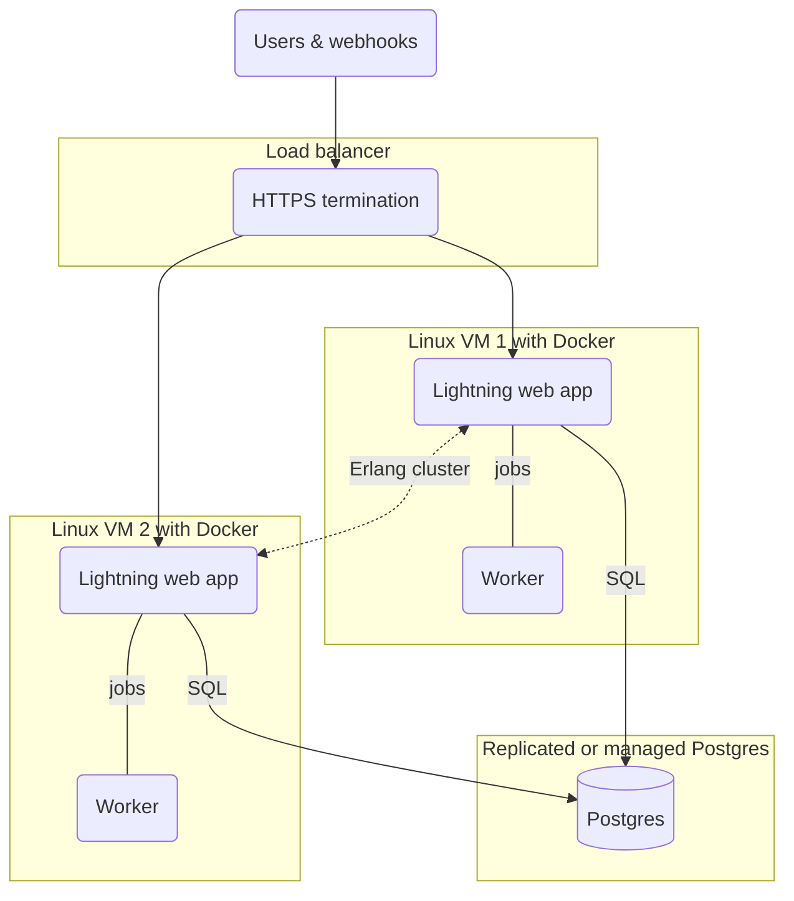
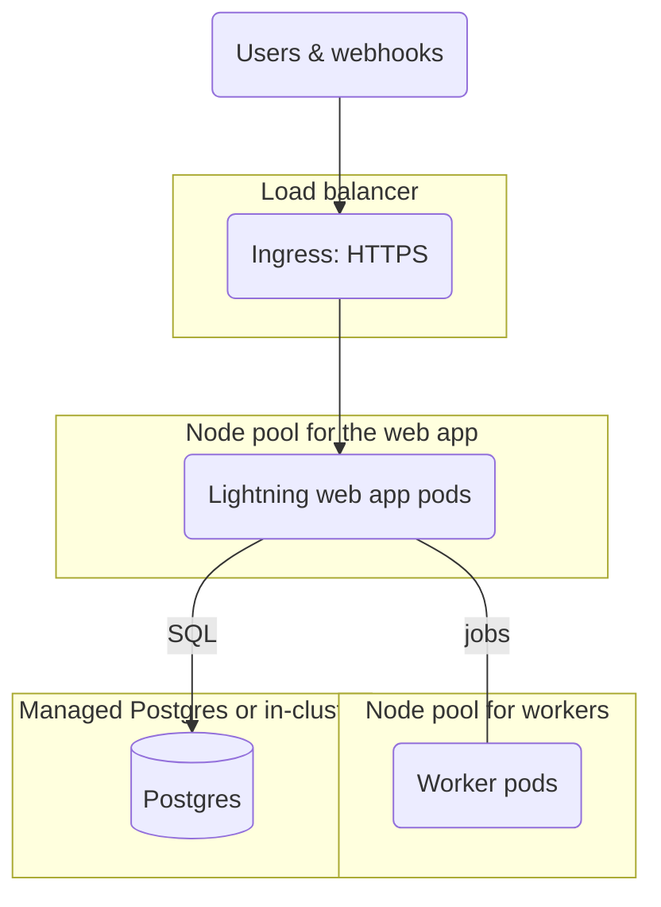

## Planifica primero {#plan-first}

¿No sabes por dónde empezar? Vuelve a la página
[Planificación](/deploy/options.md) para pensar cómo quieres escalar tus
proyectos de automatización con OpenFn.

## Evalúa tu capacidad {#assess-your-capacity}

:::info Ayuda a tu socio a estimar los costos iniciales y continuos

Usa estas preguntas para empezar a evaluar tu capacidad y tus recursos técnicos,
para que tu socio de despliegue pueda estimar mejor el costo total de propiedad.

:::

1. ¿Quién va a operar OpenFn una vez desplegado? Indica qué persona o equipo, y
   si ya ejecuta aplicaciones en contenedores (Docker o Kubernetes) en
   producción. Si todavía no puedes nombrar a nadie, empieza con un piloto en
   lugar de un despliegue en producción.
2. ¿Cómo se despliegan, supervisan y mantienen actualmente las aplicaciones en
   la nube en tu organización o gobierno? Cada entorno de despliegue y cada
   institución es única, y OpenFn es flexible: según tus procesos actuales de
   DevOps, te recomendaremos distintos mecanismos de despliegue.
3. ¿Qué personal de TI y de DevOps hay disponible para apoyar el despliegue y el
   mantenimiento de OpenFn? ¿Ese personal tiene experiencia con Docker y
   Kubernetes? ¿Y con bases de datos Postgres?
4. ¿El despliegue requerirá alta disponibilidad? (Es decir, si OpenFn va a
   recibir solicitudes en tiempo real desde otras aplicaciones en lugar de
   ejecutar jobs basados en cron, se deberían ejecutar al menos dos instancias
   de OpenFn a la vez detrás de un balanceador de carga, todas activas y unidas
   en un solo clúster de Erlang (consulta
   [Alta disponibilidad en Docker Engine](#c-high-availability-on-docker-engine)).
   Si OpenFn no va a recibir solicitudes y solo va a hacer solicitudes salientes
   con un horario cron, donde el momento exacto importa poco, mantener un
   sistema sin tiempo de inactividad es algo menos importante).
5. ¿OpenFn tiene que conectarse a herramientas que ya usas, como tus propios
   sistemas de monitoreo y alertas, tu gestor de secretos, tus pipelines de
   CI/CD o tu proceso de control de cambios? La integración con herramientas
   propias de cada cliente se presupuesta aparte de un despliegue estándar.

## Conocimientos necesarios {#knowledge-requirements}

| Habilidad     | Importancia y motivo                                                                                                                                                                                                                                                                                      |
| ------------- | --------------------------------------------------------------------------------------------------------------------------------------------------------------------------------------------------------------------------------------------------------------------------------------------------------- |
| Elixir/Erlang | La **capa de aplicación web y orquestación** de OpenFn es una aplicación Elixir que se ejecuta sobre Erlang OTP.                                                                                                                                                                                          |
| JavaScript    | Los **workers que procesan los jobs** de OpenFn y los propios workflows de OpenFn se basan en JavaScript. Si sabes cómo funciona Node.js, puedes crear workflows que hagan _cualquier cosa_.                                                                                                              |
| Postgres      | La **base de datos** predeterminada de OpenFn es PostgreSQL                                                                                                                                                                                                                                               |
| Docker        | Publicamos todas las **[imágenes](https://hub.docker.com/orgs/openfn/repositories) de OpenFn** en Docker Hub. Tanto si quieres simplificar la configuración para desarrolladores como si usas tecnologías de orquestación de contenedores, te será útil entender Docker y la computación en contenedores. |
| Kubernetes    | Kubernetes es una forma de ejecutar despliegues de **alta disponibilidad**: ofrece **balanceo de carga** y simplifica la **administración de contenedores** en varios hosts. La otra opción compatible es Docker Engine en dos o más nodos.                                                               |

## Requisitos de las máquinas {#machine-requirements}

:::tip Empieza con un entorno de ejecución de contenedores que funcione

Todo despliegue de OpenFn da por hecho que ya hay un entorno de ejecución de
contenedores (Docker Engine o Kubernetes) instalado y operado por tu equipo
antes de que empiece el despliegue. Kubernetes _no_ es obligatorio. Para un
piloto, basta con un solo host de Docker. Si tu equipo todavía no puede
aprovisionar y operar hosts de Docker o un clúster de Kubernetes, resuelve
primero esa carencia, por ejemplo, con un socio de implementación local.

:::

El SaaS oficial de OpenFn usa [Kubernetes](https://kubernetes.io/) para los
despliegues administrados en Google Cloud. Con cargas de trabajo variables, es
importante (por estabilidad y por costos) poder escalar el grupo de nodos y los
pods de la aplicación Erlang OTP por separado del grupo de nodos y los pods de
los workers de JavaScript.

1. En los despliegues de alta disponibilidad, usa un servicio SQL escalable y
   mantén _al menos_ dos nodos de la aplicación en ejecución, en Kubernetes o en
   Docker Engine en dos o más hosts. En Kubernetes (GKE), Lightning forma su
   clúster de Erlang automáticamente; en otros entornos, usa el descubrimiento
   de nodos por gossip o basado en Postgres (consulta las
   [notas de despliegue](https://github.com/OpenFn/lightning/blob/main/DEPLOYMENT.md)
   de Lightning). Especificaciones de referencia por pod de la aplicación en
   GKE:
   1. **Solicitudes de GKE (requests):** cpu@ "500m", memory@ "1024Mi"
   2. **Límites de GKE (limits):** memory@ "2560Mi"
2. Para despliegues simples sin Kubernetes ni alta disponibilidad, las máquinas
   mínimas recomendadas son:
   - **Máquina de la aplicación:** 2 vCPU (más o menos un solo núcleo de un
     Intel Xeon E5 de 2.6 GHz) con 3.75 GB de memoria y 15 GB de almacenamiento
     para la aplicación
     1. Una distribución de Linux con soporte vigente que pueda ejecutar Docker
        Engine (por ejemplo, una versión LTS actual de Ubuntu o una versión
        estable de Debian).
     2. Una versión de Docker Engine con soporte vigente.
   - **Máquina de la base de datos:** 2 vCPU (más o menos un solo núcleo de un
     Intel Xeon E5 de 2.6 GHz) con 3.75 GB de memoria. El almacenamiento que
     necesita la base de datos depende de cuántos días de datos de mensajes
     quieras guardar en la propia aplicación (si quieres guardar alguno), y no
     se puede determinar sin estimar el volumen de mensajes y runs. Si ampliar
     el almacenamiento físico no es difícil en tu despliegue, empieza con 40 GB.
     1. Una instancia de Postgres (como mínimo v14.2), ejecutada en un _servidor
        distinto_ del de la aplicación para lograr más estabilidad. En
        producción, Lightning se conecta a Postgres por SSL de forma
        predeterminada.
3. Alojar la aplicación y la base de datos en la misma máquina es aceptable para
   un piloto, pero no se recomienda para producción. Esa máquina debería tener
   aproximadamente la suma de los requisitos anteriores.
4. **Ten en cuenta** que, de forma predeterminada, la aplicación ofrece un
   endpoint HTTP (sin TLS/SSL). Se espera que un proxy inverso o balanceador de
   carga proporcione HTTPS (compatible con HTTP2) y balanceo de carga entre las
   instancias.
   - _Es decir, el servidor de la aplicación no cifra el acceso web, así que
     hace falta un servidor web delante de la aplicación; Nginx con certificados
     TLS es un buen punto de partida._
5. Aunque la arquitectura de red depende del cliente, **recomendamos firmemente
   una subred privada** para los servidores de la aplicación.
6. No hace falta desplegar la aplicación de OpenFn en la misma máquina que otros
   servicios. Sin embargo, si los sistemas de origen y destino están alojados en
   otros servidores, habrá que configurar el enrutamiento de red y las reglas
   del firewall para que la integración pueda acceder a ellos.
7. Para la **resolución de problemas y el soporte externo**, los administradores
   necesitarán acceso SSH a una cuenta sin restricciones (`sudo` en Ubuntu) si
   se requieren servicios de mantenimiento del despliegue.

## Más allá de los servidores {#beyond-the-servers}

Un despliegue en producción necesita algo más que cómputo y una base de datos.
Planifica estos puntos antes de pasar a producción:

- **Correo:** Lightning envía correos del sistema (por ejemplo, para restablecer
  contraseñas). Admite Mailgun o tu propio servidor SMTP.
- **Secretos:** Lightning necesita una clave de cifrado para las credenciales en
  reposo y un conjunto de claves para los workers. Un archivo `.env` sirve para
  un piloto; en producción se debería usar una opción de secretos adecuada para
  tu entorno de ejecución.
- **Monitoreo y alertas:** saber cuándo la plataforma o un workflow deja de
  hacer su trabajo. Lightning puede exponer métricas de Prometheus.
- **Copias de seguridad:** copias de seguridad programadas de la base de datos,
  con restauraciones que realmente se hayan probado.
- **Actualizaciones y reversión:** un proceso definido para aplicar nuevas
  versiones de OpenFn y revertirlas si algo sale mal.

Consulta las
[notas de despliegue](https://github.com/OpenFn/lightning/blob/main/DEPLOYMENT.md)
de Lightning para ver las variables de entorno de cada uno de estos puntos.

## Configuraciones posibles {#possible-configurations}

Aunque deberías planificar con cuidado tu estrategia de despliegue junto con un
especialista en DevOps, estas configuraciones de ejemplo pueden servirte como
punto de partida. Consulta
[Despliegue local con OpenFn](/deploy/options.md#local-deployment-with-openfn)
para ver cómo se corresponden con los niveles de despliegue que ofrece OpenFn.

### (a) Una sola máquina {#a-single-machine}

Ejecuta la aplicación, el worker y la base de datos en una sola máquina. Es la
configuración más simple y sirve para un piloto, pero si esa máquina falla, el
servicio no está disponible hasta que se restablece.

### (b) Persistencia separada de la aplicación {#b-separate-persistence-from-application}

Ejecuta la aplicación y el worker en una máquina, y Postgres en otra. Darle a la
base de datos su propio servidor hace que el sistema sea más estable y más fácil
de respaldar. Cada máquina sigue siendo un punto único de falla, así que esto no
es alta disponibilidad.

### (c) Alta disponibilidad en Docker Engine {#c-high-availability-on-docker-engine}

Ejecuta la aplicación y el worker en dos o más hosts de Docker detrás de un
balanceador de carga, que también se encarga de HTTPS. Si un host falla, los
demás siguen atendiendo las solicitudes. Usa un servicio de Postgres replicado o
administrado para que la base de datos no se convierta en el punto débil.

:::tip Ejecuta todos los nodos, sin nodos de reserva

Mantén todos tus nodos de Lightning en funcionamiento detrás del balanceador de
carga. No configures un nodo de reserva, ni en caliente ni en frío: todos los
nodos atienden tráfico y, si uno falla, los demás asumen su carga. Los nodos se
unen por su cuenta en un solo clúster de Erlang, así que no tienes que construir
ningún mecanismo de comunicación entre ellos.

Fuera de Kubernetes, Lightning encuentra los demás nodos mediante gossip de
forma predeterminada. Gossip usa multidifusión UDP, que la mayoría de las redes
en la nube bloquean entre máquinas virtuales. En Docker Engine con varios hosts,
establece `ERLANG_NODE_DISCOVERY_VIA_POSTGRES_ENABLED` en `true` para que los
nodos se encuentren a través de la base de datos Postgres que ya comparten.

:::

### (d) Alta disponibilidad en Kubernetes {#d-high-availability-on-kubernetes}

Ejecuta la aplicación web y el worker en grupos de nodos separados que escalan
por su cuenta, cada uno dimensionado para su carga de trabajo. Así funciona la
propia nube de OpenFn. Igual que en Docker Engine, todos los pods de la
aplicación web están activos y, en GKE, forman un solo clúster de Erlang. Para
la base de datos, usa un servicio administrado de Postgres con alta
disponibilidad o ejecuta Postgres en el clúster.

