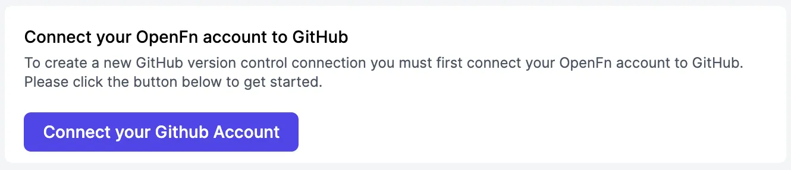
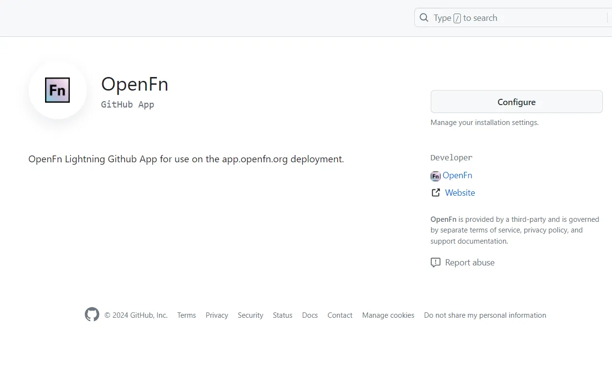
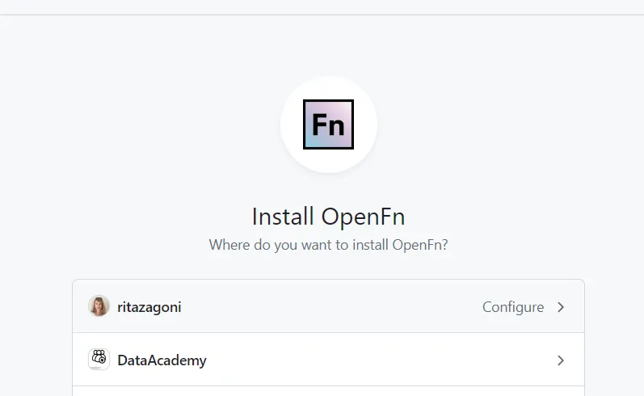
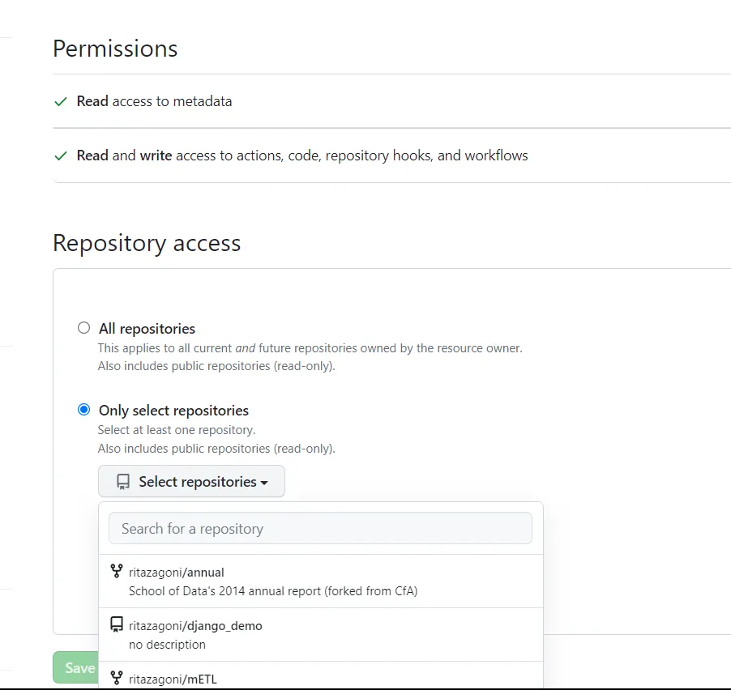
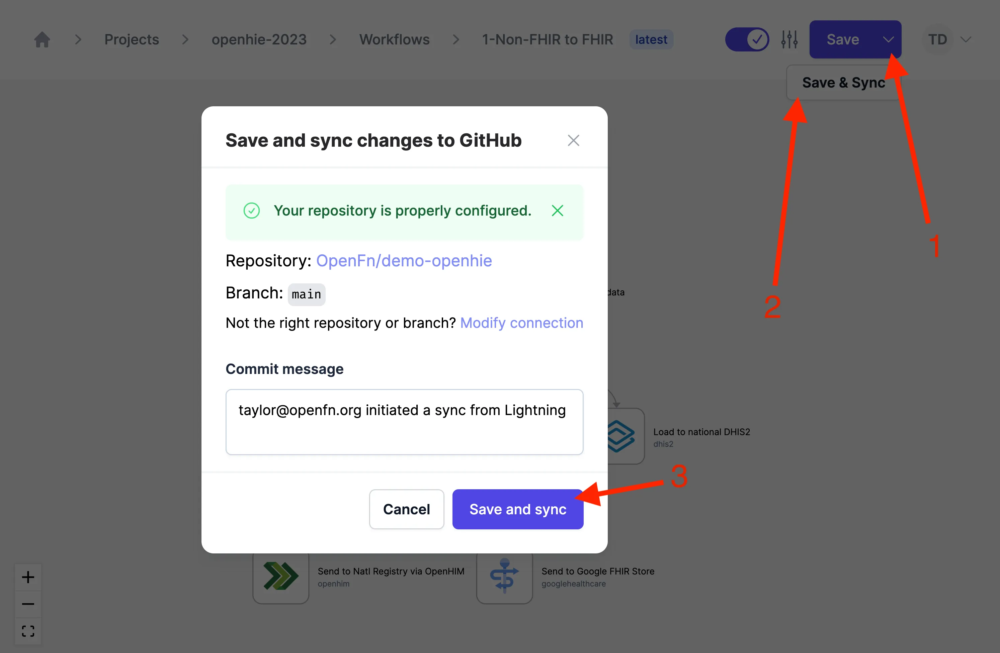
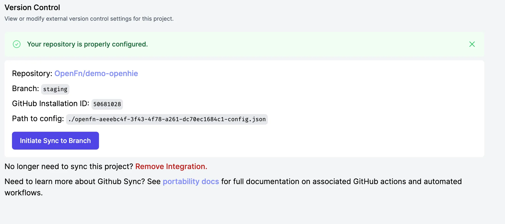

GitHub Sync permite una sincronización bidireccional entre un proyecto de OpenFn
y tu repositorio de GitHub.

Esto significa que los cambios que hagas en un proyecto en OpenFn pueden
guardarse como commits en tu repositorio de GitHub, y los commits que subas a
GitHub pueden actualizar el proyecto en tu aplicación de OpenFn.

:::info Para usuarios de OpenFn en la nube

GitHub Sync solo está disponible en proyectos con planes Core, Growth, Scale o
Custom.

:::

## Configurar tu proyecto para usar GitHub Sync {#configuring-your-project-to-use-github-sync}

Puedes configurar tus proyectos para que accedan a uno o más repositorios de
GitHub. Tienes que tener acceso de administrador al repositorio de GitHub para
poder instalar la aplicación de OpenFn.

Para configurar tu proyecto para usar GitHub Sync, sigue estos pasos:

1. Ve a `Project Settings > Sync`.

2. Si todavía no conectaste tu cuenta de usuario de OpenFn a GitHub, hazlo con
   el botón **"Connect your OpenFn account to GitHub"**.



3. Elige qué instalación de GitHub usar para tu proyecto, o sigue el consejo de
   abajo para actualizar tus instalaciones.

   :::tip

   Si no ves ninguna instalación, o si las que hay no tienen acceso a los
   repositorios que quieres, haz clic en el enlace **"Create/update GitHub
   installations or modify permissions"** para gestionar la instalación de
   OpenFn en GitHub. Para ello tendrás que darle permisos a la aplicación de
   OpenFn para acceder a tu cuenta y tu repositorio de GitHub. Si necesitas
   ayuda, consulta
   [Gestionar los permisos de GitHub](#managing-github-permissions).

   Cuando termines, puedes volver aquí y actualizar las listas con el botón 🔄
   que está junto a las listas desplegables.

   :::

4. Elige el repositorio y la rama a los que quieres conectar tu proyecto.

5. Elige la **dirección** de la _primera_ sincronización. Puedes enviar una
   copia de tu proyecto de OpenFn a GitHub (esto no afecta tu proyecto en
   OpenFn), o importar a OpenFn un proyecto que ya está en GitHub (esto elimina
   los workflows que haya en la aplicación y los reemplaza por el proyecto de
   GitHub).

6. Haz clic en **"Connect Branch & Initiate First Sync"** para terminar. Una vez
   hecho esto, puedes ir a GitHub (con el enlace que se te da) para ver tu
   proyecto de OpenFn como código (y empezar a trabajar con él).

## Gestionar los permisos de GitHub {#managing-github-permissions}

El acceso de la aplicación de OpenFn a tus repositorios de GitHub se concede _en
GitHub_, no en OpenFn. En la interfaz te damos un enlace para instalar y
gestionar estos permisos. Después de hacer clic en ese enlace, puedes seguir
estos pasos:

1. Haz clic en **"Configure"** o **"Install"**.



2. Luego selecciona la cuenta de GitHub propietaria del repositorio al que
   quieres conectarte.



3. Selecciona el repositorio que quieres sincronizar y haz clic en **"Save"**.



4. Cuando termines de hacer cambios en GitHub, vuelve a OpenFn y actualiza las
   listas de conexiones con el botón 🔄 que está junto a la lista desplegable de
   instalaciones disponibles.

## Usar el control de versiones y gestionar los cambios {#using-version-control--managing-changes}

La funcionalidad `Sync to GitHub` usa GitHub Actions para desplegar
automáticamente (después de un commit en GitHub) o traer (cuando se hace clic en
el botón **"Initiate Sync to Branch"** en OpenFn) los cambios del proyecto, y
así mantener un repositorio sincronizado con tu proyecto de OpenFn.

### Sincronizar de OpenFn a GitHub {#sync-from-openfn-to-github}

Esta sincronización envía a GitHub los cambios de tu proyecto de OpenFn. Esta
operación de sincronización dispara un workflow de acción `openfn pull` en tu
repositorio de GitHub conectado, que trae la configuración más reciente de la
aplicación de OpenFn y la guarda como código en tu repositorio. Consulta
[Estructura del proyecto](/build-for-developers/cli-sync.md#project-structure)
para saber qué se creará en GitHub.

:::info La especificación de portabilidad

Tu proyecto de OpenFn puede representarse como código. Esta representación
excluye los datos que son propios de tu aplicación, como las credenciales o los
UUID. A veces se la llama la especificación del proyecto (project spec).
Consulta la [documentación sobre portabilidad](/deploy/portability.md) para
saber más.

:::

Una vez que hayas configurado correctamente la conexión de tu proyecto con
GitHub como se explica [arriba](#configuring-your-project-to-use-github-sync),
puedes iniciar las siguientes sincronizaciones desde el Canvas, desde el
Inspector o desde la página de control de versiones de la configuración del
proyecto.

Para iniciar una sincronización desde el Canvas o el Inspector, presiona
`Ctrl+Shift+s` (o `⌘+Shift+s` en Mac; consulta los
[atajos de teclado](/keyboard-shortcuts.md)). También puedes hacer clic en el
ícono desplegable junto al botón de guardar y seleccionar `Save & Sync`. Al
hacer clic en Save & Sync, verás una ventana modal de confirmación con la opción
de personalizar el mensaje del commit.



:::info La sincronización es una acción "a nivel de proyecto"

Cuando ejecutas `Save & Sync` en un workflow, tus cambios nuevos y los cambios
_anteriores_ sin commit (si los hay) en los recursos de tu proyecto (incluidos
otros workflows) se guardan como commit en GitHub. Es decir, si tú u otra
persona hicieron cambios sin commit en otros workflows del proyecto, también
aparecerán en esa sincronización.

:::

Para sincronizar tu proyecto con GitHub desde la configuración del proyecto:

1. Ve al proyecto donde editaste tus workflows y luego a la página
   `Project Settings`
2. Desde la configuración del proyecto, ve a la página `Version Control`
   haciendo clic en `Sync to GitHub`
3. Haz clic en el botón `Initiate Sync to Branch` para disparar una
   sincronización con el repositorio de GitHub conectado



### Sincronizar de GitHub a OpenFn {#sync-from-github-to-openfn}

Usa este método de sincronización cuando quieras traer a OpenFn una versión de
tu proyecto desde GitHub. Cuando se dispara esta sincronización (con un commit
en la rama conectada), se ejecuta la acción `openfn deploy` en GitHub y los
workflows definidos allí se cargan en OpenFn.

### Configuración avanzada {#advanced-settings}

#### Formatos heredados {#use-legacy-formats}

GitHub Sync escribe tu proyecto repartido por el sistema de archivos: cada
workflow va en su propia carpeta como un archivo yaml, y todo el código de los
jobs en archivos `.js`. Este formato se rige por un archivo `openfn.yaml` en la
raíz del espacio de trabajo. Consulta
[Estructura del proyecto](/build-for-developers/cli-sync.md#project-structure)
para más detalles.

Las versiones anteriores de GitHub Sync escribían el proyecto en los archivos
`config.json`, `state.json` y `project.yaml`. Este formato sigue siendo
compatible y puedes elegirlo con la opción **"Use legacy formats"**. Si vuelves
a conectar un repositorio que ya lo usa, activa esta opción para que el
siguiente commit genere un diff más pequeño.

#### Carpeta del espacio de trabajo {#workspace-folder}

GitHub Sync escribe la representación del proyecto en una sola carpeta del
sistema de archivos (sobre todo en la carpeta `workflows`), que se conoce como
el espacio de trabajo.

De forma predeterminada, GitHub Sync lee y escribe desde la raíz de tu
repositorio.

En los repositorios organizados como un monorepo, que contienen varios
proyectos, puedes indicar la ruta de una subcarpeta para sincronizar ese
proyecto en particular. La carpeta debe apuntar al lugar donde están el archivo
`openfn.yaml` y la carpeta `workflows` del proyecto correcto.

Puedes conectar un sandbox a una rama y sobrescribir la carpeta `workflows` de
esa rama sin problema. Los sandboxes están pensados para funcionar sin tener que
indicar un espacio de trabajo distinto para cada uno.

#### Alias local {#local-alias}

Cuando un proyecto se escribe en GitHub, se le asigna un alias. Es el `main` del
archivo `main@app.openfn.org.yaml` que se crea en tu carpeta `.projects`.

El alias es un nombre corto que usan los usuarios de la CLI para referirse a un
proyecto sin tener que usar su UUID.

De forma predeterminada, un proyecto recibe el alias `main`, y un sandbox usa el
nombre del sandbox como alias.

Puedes indicar tu propio alias para el proyecto en este campo.

## Solución de problemas {#troubleshooting}

### Error de GitHub Sync: Unexpected inputs provided: ["snapshots"] {#github-sync-error-unexpected-inputs-provided-snapshots}

Si instalaste GitHub Sync antes del 17 de julio de 2024, quizás tengas que
actualizar tu archivo `.github/workflows/openfn-pull.yml` para que quede así:

```
on:
  workflow_dispatch:
    inputs:
      projectId:
        description: 'OpenFN Project ID'
        required: true
      apiSecretName:
        description: 'OpenFN API Key secret name i.e OPENFN_project_API_KEY'
        required: true
      pathToConfig:
        description: 'Path to config.json'
        required: true
      branch:
        description: 'Branch to commit the project state and spec'
        required: true
      commitMessage:
        description: 'Commit message for project state and spec'
        required: true
      snapshots:
        description: 'IDs of snapshots separated by spaces'
        required: false

jobs:
  pull-from-lightning:
    runs-on: ubuntu-latest
    permissions:
      contents: write
    name: A job to pull changes from Lightning
    steps:
      - name: openfn pull and commit
        uses: openfn/cli-pull-action@v1.1.0
        with:
          secret_input: ${{ secrets[inputs.apiSecretName] }}
          project_id_input: ${{ inputs.projectId }}
          config_path_input: ${{ inputs.pathToConfig }}
          branch_input: ${{ inputs.branch }}
          commit_message_input: ${{ inputs.commitMessage }}
          snapshots_input: ${{ inputs.snapshots }}
```
